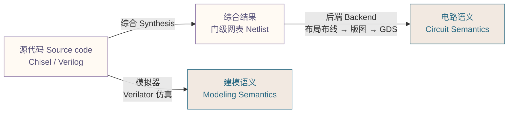
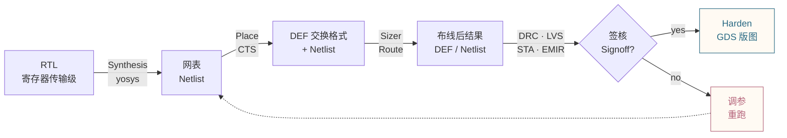
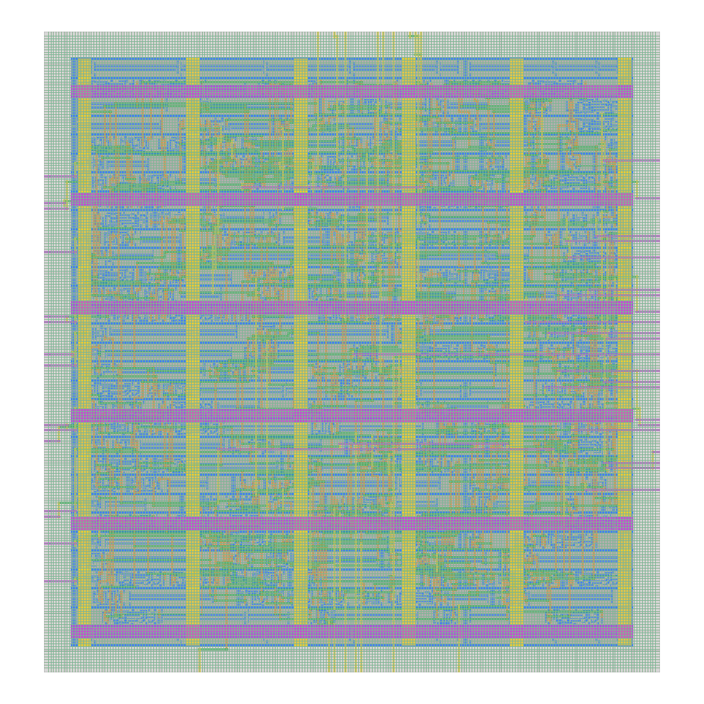
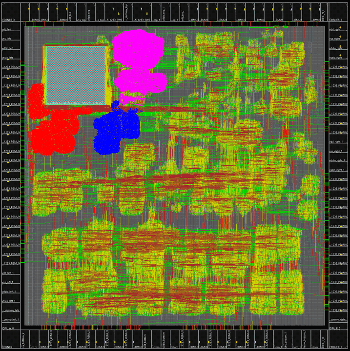
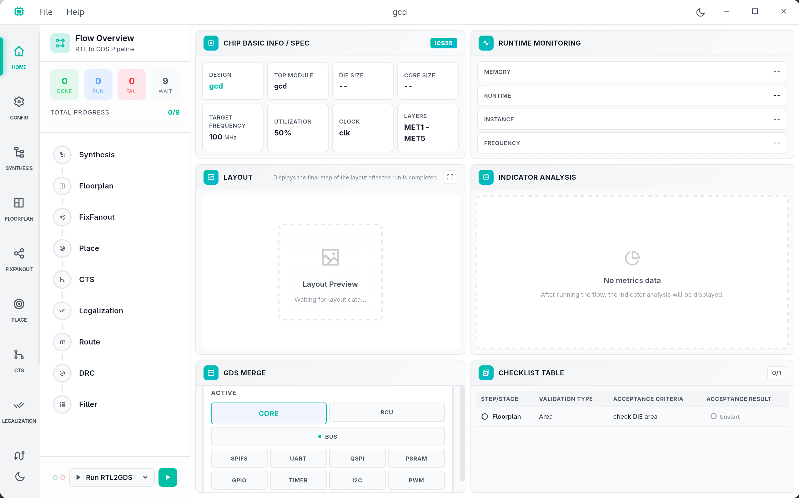
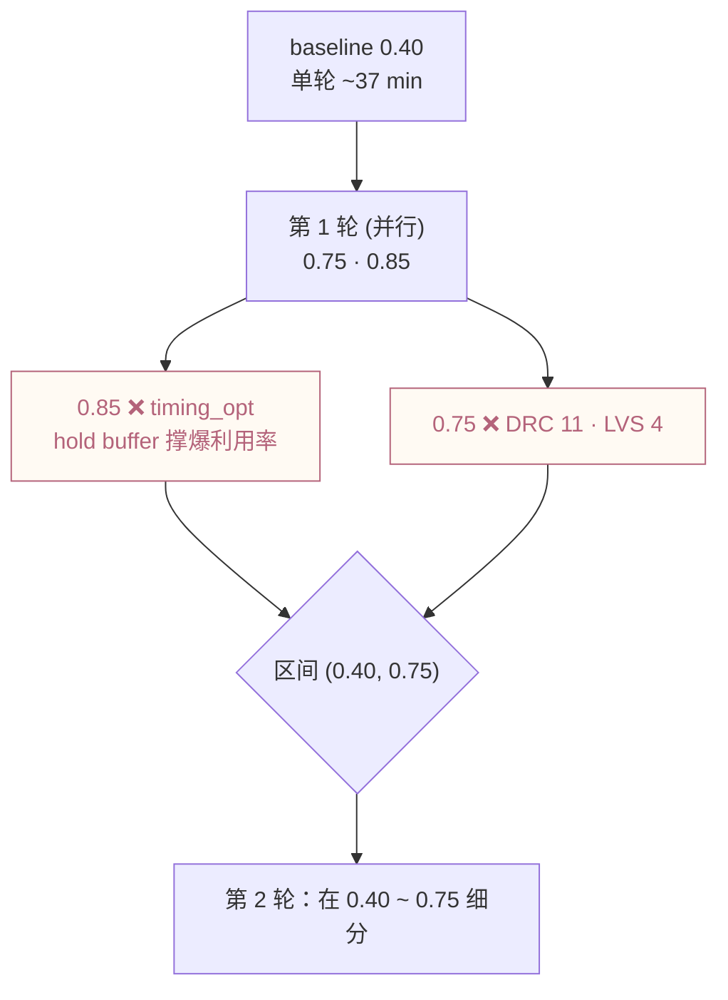
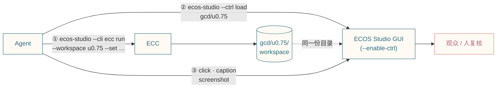
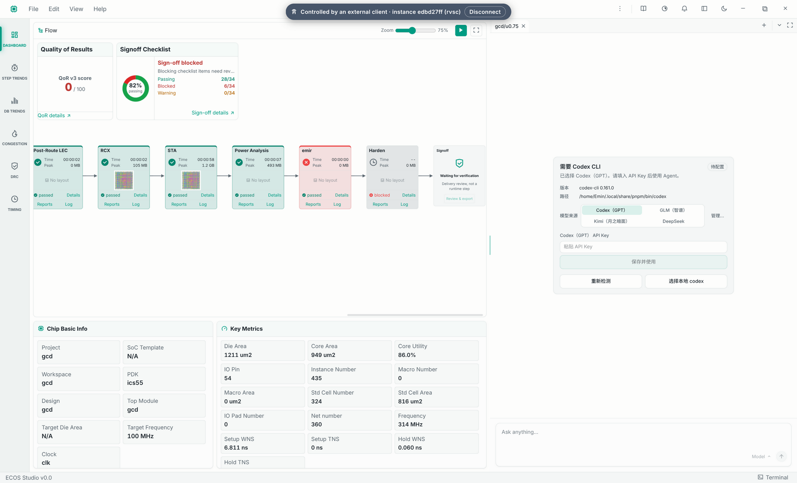

<!--
演讲开始前停留在此空白页。
翻到下一页时，封面元素将依次浮现。
-->

---
layout: cover
class: text-center
transition: cover-exit
---

<TiltLogo />

<svg class="cover-title" viewBox="0 0 640 110" role="img" aria-label="ECOS Studio">
  <defs>
    <linearGradient id="coverBeamGrad" x1="0" y1="0" x2="1" y2="0">
      <stop offset="0" stop-color="black" />
      <stop offset="0.5" stop-color="white" />
      <stop offset="1" stop-color="black" />
    </linearGradient>
    <mask id="coverBeamMask" maskUnits="userSpaceOnUse" x="-40" y="0" width="720" height="110">
      <rect class="cover-title-beam" x="-140" y="0" width="120" height="110" fill="url(#coverBeamGrad)" />
    </mask>
  </defs>
  <text class="cover-title-base" x="50%" y="75" text-anchor="middle">ECOS Studio</text>
  <g class="cover-title-light" mask="url(#coverBeamMask)">
    <text class="cover-title-glow" x="50%" y="75" text-anchor="middle">ECOS Studio</text>
    <text class="cover-title-flow" x="50%" y="75" text-anchor="middle">ECOS Studio</text>
  </g>
</svg>

## 从 RTL 到芯片的开源一站式设计解决方案

**An RTL-to-Chip Silicon Design Solution**

<div class="mt-8 text-lg opacity-80">
  RISC-V Summit China 2026 · Shenzhen · Tutorial
</div>

<div class="mt-4 text-sm opacity-60">
  演讲者：褚骐鸣 &nbsp;|&nbsp; 2026-10-19
</div>

<!--
演讲者备注：
- 开场自我介绍
- 本次 tutorial 的目标：让大家了解并上手 ECOS Studio 开源工具链
-->

---
hideInToc: true
---

# 目录

<Toc maxDepth="1" />

<!--
按现场时间调整各节时长
-->

---
hideInToc: true
---

# 使用 RTL 设计电路：

<div grid="~ cols-2 gap-6">

<div>

### 在“一生一芯”里：

- 用 Logisim 搭过数字逻辑电路 (F 阶段)
- 学过硬件描述语言 Verilog(E1)
- 用 Verilator 做过 RTL 仿真与验证 (E4)
- 写出了自己的迷你 RISC-V 处理器 (E5 NPC)
- 也许还接触过 Chisel —— 一个“生成 Verilog”的 HDL

<div v-click class="mt-10">

> Verilog 也不是“软件代码”，而是**对电路的抽象**

</div>

</div>

<div>

```verilog
module light (
  input clk, input rst,
  output reg [15:0] led
);
  reg [31:0] count;
  always @(posedge clk) begin
    if (rst) begin
      led <= 1; count <= 0;
    end else begin
      if (count == 0)
        led <= {led[14:0], led[15]};
      count <= (count >= 5000000
                ? 32'b0 : count + 1);
    end
  end
endmodule
```

<div class="mt-2">

> `always @(posedge clk)` → 寄存器 · 组合逻辑 → 门电路 · module 层次 → 电路结构

</div>

</div>

</div>

<!--
右側流水灯代码直接取自 ysyx D6 讲义，全场都见过
提问互动：这段 Verilog 综合出来是什么？
-->


---
hideInToc: true
---

# Verilog 也是一种“电路生成器”

<div grid="~ cols-2 gap-8">

<div>

### 一个在某种程度上成立的观点：

**Verilog 本身就是一种电路生成器** —— 它用状态机与事件的语义描述硬件，再由综合器翻译成物理电路。

而 **Chisel** 再上一层：它是一个**生成 Verilog 的电路生成器**(Scala 元编程 → FIRRTL → Verilog)。

</div>

<div v-click="1">

### 更高层次语言的目的

- **限制**我们需要考虑的底层实现细节
- 获得一种**更接近最终要解决的问题**的思路
- 设计一个更高层次的语言，并给它定义一套**不涉及无关细节的语义**

</div>

</div>

<div v-click="2" class="mt-6">

### 下面三条 Verilog 语句，在 ICS55 PDK 里会综合成什么？

</div>

<div grid="~ cols-3 gap-4">

<div>

<div v-click="2" class="code-sm">

```verilog
// 组合逻辑
assign y = s ? a : b;
```

</div>

<div v-click="3" class="code-sm">

```verilog
// ↓ 多路选择器
MUX2X0P5H7R _0_ (
  .A(b), .B(a), .S0(s), .Y(y));
```

</div>

</div>

<div>

<div v-click="2" class="code-sm">

```verilog
always @(posedge clk)
  q <= d;
```

</div>

<div v-click="3" class="code-sm">

```verilog
// ↓ D 触发器
DFFQX1H7R _0_ (
  .CK(clk), .D(d), .Q(q));
```

</div>

</div>

<div>

<div v-click="2" class="code-sm">

```verilog
always @(*)
  if (en) y = a;
```

</div>

<div v-click="3" class="code-sm">

```verilog
// ↓ 锁存器！
LATHX1H7R _0_ (
  .G(en), .D(a), .Q(y));
```

</div>

</div>

</div>

<!--
三个目的展开：语言设计者把“不关心的细节”挡在语义之外
后端工具链正是这套思路的工程化：综合/后端替你处理电路语义域的细节
Latch 例子可与 F3 数字逻辑呼应:y 在 en=0 时要保持，综合器只能推导出锁存器
三个实例是用 ICS55 typ 库 (ics55_LLSC_H7CR_typ_tt_1p2_25_nldm.lib) 真实综合出来的：
- mux/dff:yosys synth + dfflibmap + abc
- latch:dfflibmap 不处理 latch,ECC 的 yosys_synthesis.tcl 用 techmap 把 $_DLATCH_P_ 映射成 LATHX1H7R，这里照做
MUX 的 A/B 和源码里的 a/b 是反的：库函数是 Y = A·!S0 + B·S0，而源码 s=1 选 a，所以 a 接 B —— 综合器替你处理了这个细节
讲义 E8 也提到:ICS55 里锁存器单元以 LAT* 开头，可以在网表里搜它来检查有没有意外生成 latch
-->

---
hideInToc: true
---

# 从 RTL 到芯片：中间隔着什么？

同一份 HDL 源代码中存在**两个语义域**：模拟器和 RTL 设计人员看到的是**建模语义**,经过综合与后端才能抵达**电路语义**:



- **综合**:把 RTL 逻辑元件映射成物理标准单元 (D6 中的“电路评估”)
- **物理设计 (后端)**:标准单元网表 → 布局布线 → 可流片版图 (E8 / D6 的核心)
- 无论手写 Verilog 还是 Chisel 生成，最终都需要接入**后端流程**完成版图生成
- 这一步传统上需要：昂贵的商业 EDA、NDA 保护的 PDK、复杂的流程集成……

**这正是 ECOS Studio 要解决的问题**

<!--
承接上一页：功能验证 (仿真) 只是第一步
点题:E8“后端物理设计和流片准备”/ D6“从 RTL 代码到可流片版图”就是今天要讲的工具链
自然过渡到下一页“背景与动机”展开痛点
-->


---

# ECOS Studio：把这条路串起来

<div grid="~ cols-2 gap-8" class="items-center">

<div>

- **ECC** (ECOS Chip Compiler) — 开源 RTL-to-GDS **编译器**,有 CLI 与 Python API
- **ECOS Studio** — 桌面 GUI,ECC 的一个**前端**:可视化、对比、导出
- **ICsprout55** — 开源 55nm PDK，无需 NDA
- **retroSoC** — 可组合的 RISC-V SoC IP

<div class="mt-6">

> 今天的主线：同一个 ECC，三种用法 —— **命令行 → GUI → Agent**

</div>

</div>


</div>

<!--
不再逐个组件展开介绍，只给一个地图
强调 GUI 只是 ECC 的前端之一，后面所有 demo 都在操作同一个 ECC
-->

---

# 第一部分:ECC — 一个“芯片编译器”



<div class="text-sm mt-2">

|      | 源码     | 中间表示     | 映射到目标 | 物理落地                                                             | 目标描述       | 调优旋钮     | 正确性检查        |
| ---- | -------- | ------------ | ---------- | -------------------------------------------------------------------- | -------------- | ------------ | ----------------- |
| LLVM | [`.c`](https://clang.llvm.org/docs/UsersManual.html) | [LLVM IR](https://llvm.org/docs/LangRef.html) | [ISel](https://llvm.org/docs/CodeGenerator.html#instruction-selection-section) → [MIR](https://llvm.org/docs/MIRLangRef.html) | [MachineScheduler](https://github.com/llvm/llvm-project/blob/main/llvm/lib/CodeGen/MachineScheduler.cpp)<br>[RegAlloc (Greedy)](https://github.com/llvm/llvm-project/blob/main/llvm/lib/CodeGen/RegAllocGreedy.cpp)<br>[PrologEpilog](https://github.com/llvm/llvm-project/blob/main/llvm/lib/CodeGen/PrologEpilogInserter.cpp)<br>[BlockPlacement](https://github.com/llvm/llvm-project/blob/main/llvm/lib/CodeGen/MachineBlockPlacement.cpp) | [目标描述 `.td`](https://llvm.org/docs/TableGen/index.html) | [`-O2` 等选项](https://clang.llvm.org/docs/CommandGuide/clang.html#cmdoption-O2) | [Verifier](https://llvm.org/docs/Passes.html#verify-module-verifier) / [Alive2](https://github.com/AliveToolkit/alive2) |
| ECC  | `.v` RTL | [RTLIL](https://yosyshq.readthedocs.io/projects/yosys/en/latest/yosys_internals/formats/rtlil_rep.html) /<br>网表 Netlist | [工艺映射<br>Technology mapping](https://yosyshq.readthedocs.io/projects/yosys/en/latest/using_yosys/synthesis/techmap_synth.html) | [Floorplan](https://github.com/openecos-projects/ecc-tools)<br>[Place](https://github.com/openecos-projects/ecc-dreamplace) · [CTS](https://github.com/openecos-projects/ecc-tools)<br>[Sizer](https://github.com/openecos-projects/ecc-sizer)<br>[Route](https://github.com/openecos-projects/ecc-tools) | [PDK](https://github.com/openecos-projects/icsprout55-pdk) | [`ecc param`](https://github.com/openecos-projects/ecc/blob/emin/add-agent-ctrl/chipcompiler/docs/ecc-user-guide.cn.md#9-param--参数管理) | [DRC · LVS](https://github.com/openecos-projects/ecc-tools) · [LEC](https://github.com/openecos-projects/kepler-formal) |

</div>

<!--
讲义 E8 里大家是在 GUI 里点开始按钮;这里先揭开 GUI 背后的那个编译器
用编译器 lowering 的术语讲，学过编译原理 / PA 的同学可以直接套用：
- LLVM IR ↔ RTLIL:与目标无关的中间表示，前端 (clang / yosys) 生成，在上面做优化
- 指令选择 (ISel) ↔ 工艺映射：把通用操作覆盖成目标真有的东西 —— 指令 vs 标准单元 (abc 做的就是覆盖)
- 物理落地：把抽象的东西落到有限的物理资源上 —— 物理寄存器 / 指令顺序 vs 芯片上的坐标和金属层
  - MachineScheduler (排指令顺序) ↔ Place (排单元位置)
  - RegAlloc (分配有限的寄存器) ↔ Route (分配有限的布线轨道)
  - PrologEpilog / BlockPlacement (插入栈帧、调整布局) ↔ CTS / Sizer (插入时钟树、调整单元尺寸)
  - 这些是"同一类问题"的类比，不是一一对应的等价
- TableGen .td ↔ PDK:描述目标机器 —— 指令/寄存器/时序模型 vs 标准单元库/LEF/设计规则
- Verifier / Alive2 ↔ DRC · LVS · LEC:检查每一步 lowering 没有引入错误 (Alive2 做翻译验证，对应 LEC 的等价性检查)
注意右边的回路：后端设计的日常就是“调参重跑”,这是后面 Agent 部分的伏笔
-->

---
hideInToc: true
---

# 安装：一个 nightly 包装齐整条工具链

`ecos-nightly-linux-x86_64.tar.gz` 里有 ECC、Sizer、kepler-formal、ICsprout55 PDK 和 ECOS Studio:

<div grid="~ cols-[3fr_2fr] gap-6">

<div>

```bash
# 下载、校验、解压，补上 yosys 和环境脚本
tools/install-ecos-nightly.sh

source ecos-nightly/ecos-nightly-linux-x86_64/ecos-env.sh
ecc version
ecc doctor          # 环境体检：yosys / sizer / kepler-formal
```

- `ecos-env.sh` 把 `ecc`、Sizer、kepler-formal 放进 PATH，并指好 PDK
- 包里不含 yosys，安装脚本会顺带下载 OSS CAD Suite
- 同一个 ECC 也给 ECOS Studio 用：`ecos-env.sh` 不带参数直接启动 Studio

</div>

<div class="code-sm">

```console
$ ecc version
ecc 0.1.0a12
dreamplace 0.1.0a7
ecc_tools 0.1.0a13
runtime ECC CLI
yosys 0.70+post
sizer 0.1.0-alpha
klayout 0.30.2

$ ecc doctor --plain
doctor=environment status=ok checked=9 failed=0
```

</div>

</div>

<!--
本页及后续 CLI 输出均来自 ecos-installer nightly v0.1.0-nightly.20261013 (ECC 27084f4),2026-10-19 实测
tools/install-ecos-nightly.sh:下载并校验 SHA-256，补上 pdk/techfile/icsprout55.layermap (这个 nightly 的 PDK 缺它，pre_floorplan 会报 gds_save requires -layer_map),再装 ecos-env.sh
yosys 不在 nightly 里：安装脚本下载 OSS CAD Suite 2026-10-19 到 bundle/oss-cad-suite,ecos-env.sh 设置 CHIPCOMPILER_OSS_CAD_DIR 指向它 (已设置时不覆盖，例如 nix develop);NixOS 上仍建议在 nix develop 里跑，补 xcb / fontconfig / libcrypt
ECOS Studio 的 AppImage 目前不内置 ECC，而是通过 ECOS_ECC_BIN_DIR 用这个包里的 ecc (ecos-env.sh 会设置)
-->


---
hideInToc: true
---

# 第一个项目:ecc init → pdk set-root

<div grid="~ cols-2 gap-6">

<div>

```bash
mkdir ~/ecc-demo && cd ~/ecc-demo
ecc init gcd && cd gcd
# 没有自己的 RTL？用仓库里的 gcd 示例
cp /path/to/rvsc-tutorial-2026/examples/gcd/rtl/gcd.v rtl/
```

<div class="code-sm">

```toml
# 生成的 ecc.toml
[design]
name = "gcd"
top = "gcd"            # 顶层模块名
rtl = ["rtl/gcd.v"]
clock_port = "clk"     # 时钟端口名
frequency_mhz = 100.0  # 目标频率

[pdk]
name = "ics55"
root = ""              # 留空则读环境变量

[flow]
preset = "rtl2gds"
skip_steps = ["lec"]   # 综合级 LEC 默认跳过
```

</div>

</div>

<div>

```bash
# 设置 PDK 路径，并校验 PDK 内容
ecc pdk set-root ~/icsprout55-pdk
ecc doctor   # 环境体检
```

<div class="code-sm">

```console
[status]
  pdk: set-root
  status: set
  config: ecc.toml
```

</div>

> `top`、`rtl`、`clock_port`、`frequency_mhz` 必须和 RTL 一致 —— 即 GUI 向导里的 Spec Setting

</div>

</div>

<!--
gcd.v 来自仓库 examples/gcd/rtl/gcd.v(ECC docs/examples/gcd/gcd.v,Apache-2.0);没有自己的 RTL 的学员直接拷贝这一份
本分支的 ecc check 要求先有 workspace:新项目上直接跑会报 workspace_required (declared workspaces: none)
所以第一次运行前用 pdk set-root + doctor 做体检;跑过一次后 ecc check --workspace <ws> 才可用
PDK 不完整 (没 make unzip) 时，pdk set-root 会直接报 tech LEF / LEF / liberty 缺失
skip_steps = ["lec"] 是默认值：综合级 LEC 默认跳过，布线后 LEC (postRouteLec) 照常运行
-->

---
hideInToc: true
---

# ecc run:一条命令跑到签核

<div grid="~ cols-2 gap-6">

<div>

```bash
ecc run --workspace u0.4   # 默认 preset = rtl2gds
ecc status --workspace u0.4   # 另开终端看进度
ecc log placement --workspace u0.4
```

<div class="code-sm">

```console
synthesis      0:0:20   lvs           0:0:0
pre_floorplan  0:0:0    drc           0:0:0
macro_place    0:0:1    antennacheck  0:0:0
post_floorplan 0:0:0    postroutelec  0:0:2
preplace       0:0:13   rcx           0:0:1
placement      0:25:26  sta           0:0:57
diff_sizing    0:9:3    poweranalysis 0:0:6
cts            0:0:12   emir          incomplete
legalization   0:0:0    harden        unstart
timing_opt     0:0:15
routing        0:0:3
filler         0:0:0
```

</div>

</div>

<div>

### 读懂这张表

- `rtl2gds` 一共 **21 步**,每一步一个子目录：`u0.4/<Step>_<tool>/{log,output,report}`
- 失败后 `ecc run --workspace u0.4 --resume` 从断点续跑，已成功的步骤不重跑
- 大头是 **placement + diff_sizing**,gcd 在 8 核 CPU 上约 35 分钟
- 签核链比较长：LVS · DRC · antenna check · post-route LEC · RCX · 13 corner STA · power · EMIR

<div class="mt-4">

> 讲义 E8 在 GUI 里从 Floorplan 开始、导入综合后的网表;CLI 这里直接从 RTL 开始，综合也交给 ECC

</div>

</div>

</div>

<!--
数据来自 2026-10-17 实测:ECC emin/add-agent-ctrl (d5b04c3c),gcd core_util=0.4,8 核 CPU、无 GPU
左侧是 ecc status --plain 的整理版 (原始输出每步两行，太长)
emir incomplete:nightly PDK 缺 EMIR 工艺文件 (EMIR technology_file_path is a placeholder),PDK 修好后重跑并替换
diff_sizing 需要约 6.3 GiB 可用内存;placement 在 CPU 上收敛慢 (overflow 在 0.18~0.33 间震荡约 430 次迭代)
-->

---
hideInToc: true
---

# 结果：版图、报告、签核包

<div grid="~ cols-[2fr_3fr] gap-6">

<div>



<div class="text-xs opacity-60 mt-1 text-center">

`u0.4/filler_ecc/output/gcd_filler.png`

</div>

<div class="code-sm">

```bash
ecc report summary --workspace u0.4
ecc signoff inspect --workspace u0.4
ecc signoff export --workspace u0.4 -o gcd.tar.gz
```

</div>

</div>

<div class="code-sm">

```console
[ 1. PHYSICAL & AREA METRICS ]
  Die Area            2161.44 um²
  Core Utilization    45 %
[ 2. TIMING CLOSURE & PERFORMANCE ]
  Target Clock Period 10 ns       Target freq: 100 MHz
  Achieved Fmax       487 MHz
  Setup Slack (WNS)   7.95 ns     TIMING MET
  Hold Slack  (WNS)   0.04 ns     TIMING MET
[ 7. PHYSICAL VERIFICATION ]
  DRC Status          CLEAN (0 violations)  PASS
  LVS Status          MATCHED (Clean)       PASS

[signoff]
  status : blocked
  risks:
    [blocked] Signoff checklist unavailable   # emir 未跑完
```

</div>

</div>

> GUI 的 Export Signoff Package / Checklist / Key Metrics = 这里的 `signoff export` / `signoff inspect` / `report summary`

<!--
数据来自 2026-10-17 实测:ECC emin/add-agent-ctrl,gcd core_util=0.4
DRC/LVS/STA 都通过，但 emir 缺 PDK 的 EMIR 工艺文件没跑完，所以 Harden 没跑、签核清单不可用 → blocked
PDK 修好后重跑：期望 signoff 变为 attention (只缺 macro_locations 这类可选项),并替换为 Harden 版图
只有 blocked 才会拒绝导出，attention 不影响
-->

---
hideInToc: true
---

# 签核包交付：拼片流片模板

签核包导出后，提交到 [开芯工厂](https://factory.openecos.com/templates) 选一个模板投片。三个模板，其实只有**两种模式**:

<div class="text-sm">

| 模板      | 模式    | 面积                | 交付物              | IO                 | 适合                       |
| --------- | ------- | ------------------- | ------------------- | ------------------ | -------------------------- |
| **MPW**   | **MPW** | ≥ 1 mm × 1 mm 独立裸片 | 一个 GDS            | 整颗裸片的 IO      | 完整 SoC、MCU、混合信号    |
| **Frame** | **MPC** | 0.001 – 1 mm²       | DEF + 门级网表      | 最多 73 路 user_io | 小型 ASIC 模块、早期验证   |
| **OSOC**  | **MPC** | 课程规定            | DEF + 门级网表      | 课程环境           | 一生一芯 CPU 流片 (需审核) |

</div>

<div grid="~ cols-[3fr_1fr] gap-6" class="mt-2">

<div>

- **MPW** (Multi-Project Wafer):多个项目拼在同一片晶圆上，但每个设计是**独立的裸片**，可以自己封装
- **MPC** (Multi-Project Chip):多个设计拼进**同一颗芯片**,共用已验证的 pad ring、IO wrapper、封装和板卡 —— Frame 和 OSOC 都是这种
- 所以 Frame / OSOC 只交 **DEF + 网表**,不用自己做焊盘;这正是 ECC 布线后输出的东西

</div>

<div>



<div class="text-xs opacity-60 mt-1 text-center">拼片完成的 MPC 芯片</div>

</div>

</div>

<!--
数据来自 factory.openecos.com/templates 的 templates.json (2026-10-17 抓取):
- mpw:Dedicated die, 1 mm x 1 mm, Upload one .gds file, package mpw-v1
- mpc-frame:Shared MPC chip, 0.001 – 1 mm2, Upload one .def plus one .v or .sv gate-level netlist, up to 73 signals, package mpc-frame-v1
- osoc:mode MPC, Course-defined, same handoff as Frame, "OSOC / ysyx CPU tapeout track", eligibility required
MPC 共享裸片：116 个焊盘、96 个封装引脚、每边 29 个焊盘;Frame 提供 user_io[72:0]
讲义 E8 说的"你的版图会和其他学生的版图一同接入 ysyxSoC",就是 OSOC 这个 MPC 模板
网站上标"预计"的费用只供评估，以订单报价为准，所以这里不写价格;下一页用 ICsprout55 的单价算
-->

---
hideInToc: true
---

# 流片按面积收费

<div class="text-sm">

| 阶段 | 可流片设计                         | 综合面积 (mm²) | 物理设计面积 (mm²) | MPW 价格 (元) | 全掩膜价格 (元) |
| ---- | ---------------------------------- | -------------- | ------------------ | ------------- | --------------- |
| F    | sCPU,8 位 CPU,4 条指令            | 0.0006         | 0.001              | 30            | 7.5             |
| E    | minirv (8+1 条指令，多周期) + SimpleBus | 0.007          | 0.0117             | 350           | 87.5            |
| D    | RV32E (45 条指令，多周期) + SimpleBus | 0.009          | 0.015              | 450           | 112.5           |
| C    | RV32E (多周期) + AXI               | 0.009          | 0.015              | 450           | 112.5           |
| B    | RV32E (流水线) + cache + AXI       | 0.015          | 0.025              | 750           | 187.5           |
| A    | 同上，支持特权级、虚存，可启动 Linux | 0.2            | 0.333              | 10000         | 2500            |

</div>

> ICsprout55 流片价格：**MPW 30000 元/mm²**,**全掩膜 7500 元/mm²** —— 价格只和**物理设计面积**成正比

<div v-click class="mt-4">

注意每一行：**物理设计面积 ≈ 综合面积 ÷ 0.6**。多出来的 40%

</div>

<!--
价格表来自 ysyx 讲义 / ICsprout55 报价 (用户提供，2026-10-19)
每行核对过：物理设计面积 × 30000 = MPW 价格，× 7500 = 全掩膜价格 (E 行 0.0117 × 30000 = 351，表中取整为 350)
每行 综合面积 / 物理设计面积 = 0.60:这张表默认按 60% 利用率估算物理面积
如果把利用率从 60% 提到 75%,A 阶段的 MPW 价格从 10000 元降到约 8000 元 (0.2 / 0.75 × 30000)
-->

---
hideInToc: true
---

# 利用率：面积里有多少是真正的电路

<div grid="~ cols-2 gap-8">

<div>

**利用率** = 标准单元总面积 ÷ core 面积

<div class="code-sm">

```text
┌─ DIE ────────────────┐ ← die：按面积收费
│ ┌─ CORE ───────────┐ │ ← core：floorplan 决定
│ │ ## .. ## .. ## . │ │
│ │ .. ## .. ## .. # │ │   ## 标准单元 = 电路
│ │ ## .. ## .. ## . │ │   .. 空白 = routing / stripe
│ └──────────────────┘ │
└──────────────────────┘ ← 2 µm margin · IO pin
```

</div>

利用率越高，空白越少、面积越小、越便宜；太挤则布线绕不开，出现 DRC 违例。

</div>

<div>

用 gcd 在 ECC 上实测 (`floorplan.core_util`):

<div class="text-sm">

| 利用率 | 标准单元 | Die 面积 | MPW 估价 | DRC |
| ------ | -------- | -------- | -------- | --- |
| 0.40   | 818 µm²  | 2161 µm² | 64.8 元  | ✅ clean |
| 0.75   | 816 µm²  | 1211 µm² | 36.3 元  | ❌ 11 处 |

</div>

<div class="mt-3">

> 电路几乎没变，面积省了 **44%**。<br>
> 问题变成：**能签核的最大利用率是多少？**

</div>

</div>

</div>

<!--
gcd 数据来自 2026-10-17 实测:ECC emin/add-agent-ctrl,u0.4 / u0.75 的 ecc report summary
标准单元面积两者几乎相同 (818.44 vs 815.64 µm²),说明省下的全是"空白"
MPW 估价 = Die 面积 × 30000 元/mm²:2161.44 µm² → 64.84 元，1211.04 µm² → 36.33 元
0.75 的 DRC 11 处 (4 处 metal short + 7 处 spacing),所以这里还不能直接用 0.75 —— 引出下一页的调参
实际报告里的 Core Utilization 是 45% / 86%,和设定值 0.4 / 0.75 不完全相等 (tap cell、站点对齐等)
ECC 的 PDN 没有 power ring (2026-10-17 核对 u0.4):
- config/floorplan_ecc.json 的 pdn_generator 只有 global_connect / rail / stripe / connect_layers 四项，没有 ring
- 布线后 DEF 的 SPECIALNETS (VDD/VSS) 只有 FOLLOWPIN (MET1 rail) 和 STRIPE (MET1~MET5),SHAPE RING 为 0
- core 与 die 之间只有 die_builder.margin = 2 µm,54 个 IO pin 放在 die 边上
- 所以 core 外圈的"边距"很窄，面积差主要来自 core 内部的空白 (利用率)
-->

---
hideInToc: true
---

# 在 ECC 里改利用率：`floorplan.core_util`

<div grid="~ cols-2 gap-8">

<div>

floorplan 默认是 `die_util` 模式，**由利用率反推 core 大小**:

<div class="code-sm">

```text
core ≈ 综合后的 cell 面积 ÷ core_util
die  = core + 四周 core_margin
```

</div>

gcd 实测，综合 cell 面积 709.24 µm²:

<div class="text-sm">

| `core_util` | 709.24 ÷ util | 实际 core |
| ----------- | ------------- | --------- |
| 0.40        | 1773 µm²      | 1805 µm²  |
| 0.75        | 946 µm²       | 949 µm²   |

</div>

</div>

<div>

和面积相关的几个参数：

<div class="text-sm">

| 参数                      | 默认       | 作用                         |
| ------------------------- | ---------- | ---------------------------- |
| **`floorplan.core_util`** | 0.4        | **改这个**,决定 core 有多大  |
| `floorplan.core_margin`   | `[2, 2]`   | core 到 die 边的距离 (µm)    |
| `floorplan.aspect_ratio`  | 1.0        | core 宽高比                  |
| `die_builder.mode`        | `die_util` | `die_size` 则直接给宽高      |
| `place.target_density`    | 0.4        | placement 目标密度，不改面积 |

</div>

</div>

</div>

<!--
数据来自 2026-10-17 实测:ECC emin/add-agent-ctrl,gcd
- 综合 cell 面积:Synthesis.log 里 "Chip area for module '\gcd': 709.240000"
- core 面积:postFloorplan 的 qor_metrics.json,1805.44 / 948.64 µm²
- 709.24 / 0.4 = 1773.1,709.24 / 0.75 = 945.7，和实际 core 面积相差 1.8% / 0.3%,差值来自行高和 site 对齐取整
- 参数列表来自 ecc param list --step floorplan;core_margin 默认 [2, 2] µm，和 DEF 里 ROW 起点 (2000, 2000) 一致
place.target_density 的证据:place.log 里 "target_density 0.4 is smaller than utilization 0.530044, ignored"(u0.75 是 0.855743)
所以想压面积，只需要改 floorplan.core_util;DRC 不过时，可以再考虑调 target_density 让 cell 摆得更匀
报告里的 Core Utilization (45% / 86%) 比设定值高，因为它按 Sizer 和 hold buffer 之后的 cell 面积算，cell 变多了
-->

---
hideInToc: true
---

# 调参：一个参数集 = 一个 workspace

要找出最大可签核利用率，只能“改参数 → 重跑 → 对比”。在 CLI 里这样做：

<div grid="~ cols-2 gap-6">

<div>

```bash
# 看参数：值 / 默认 / 范围 / 作用的步骤
ecc param show floorplan.core_util
# 每个变体开一个 workspace，原结果不动
ecc run --workspace u0.75 --set floorplan.core_util=0.75
ecc run --workspace f200 --set design.frequency_mhz=200
# 中断 / 失败后续跑，已成功的步骤不重跑
ecc run --workspace u0.75 --resume
# 看对比
ecc signoff inspect --workspace u0.75
```

<div class="code-sm">

```console
  floorplan.core_util
    value 0.4   default 0.4   type float
    applies floorplan   range [0.01, 1.0]
```

</div>

</div>

<div>

### 讲义里的决策规则

<div class="text-sm">

| 不达标的项      | 调整方向     |
| --------------- | ------------ |
| STA (setup)     | 降低目标频率 |
| DRC / LVS       | 降低利用率   |
| Die Area 太大   | 提高利用率   |

</div>

<div class="mt-4">

> 那么：**能成功生成签核包的最大利用率**是多少？要跑几轮、每轮多久、能不能并行？

</div>

</div>

</div>

<!--
这个问题来自讲义 E8 "探索 ECOS Studio",是后面 Agent 部分的主线：
它本质上是一个带黑盒评估函数的搜索问题
-->

---

# 第二部分：在 GUI 里看结果、辅助开发者进行决策

CLI 适合**批量跑 Flow**,GUI 适合**用来查看具体报错信息**。两者操作的是同一个项目目录：

<div grid="~ cols-2 gap-6">

<div>

### 把 CLI 跑出来的项目导入 GUI

1. 启动 AppImage (不带 `--cli`)
2. **Projects** 页 → **Import Project**
3. 选择 `~/ecc-demo/gcd` (含 `project.json` 的目录)
4. 列表里出现 `u0.4`、`u0.75`、`u0.85` … 每个 workspace 一行

```text
gcd/
├── ecc.toml        # 项目声明
├── project.json    # workspace 登记表 ← GUI 读这个
├── u0.4/
├── u0.75/
└── u0.85/
```

</div>

<div>



<div class="text-sm opacity-60 mt-2 text-center">首页 → Backend Design → Projects</div>

</div>

</div>

<!--
反过来也行：GUI 向导创建的 workspace 也能用 ecc status --project <dir> --workspace <ws> 查看
现场操作：导入刚才 CLI 跑完的 gcd 项目
Projects 页的对比表 (Progress / QoR / Blocking / Signoff) 是 GUI 相对 CLI 的最大优势
-->

---
hideInToc: true
---

# Project 总览：一眼对比所有 workspace

<div grid="~ cols-[3fr_2fr] gap-6">

<div>


<div class="text-sm opacity-60 mt-2 text-center">Projects → gcd → Dashboard</div>

</div>

<div>

- **左侧 workspace 列表**
  每个参数变体一行：u0.4 / u0.6 Success,u0.7 / u0.9 Place failed,u0.75 Timing Opt failed
- **Flow progress**
  多少个跑完、DRC clean、Signoff ready
- **Recommended workspace**
  按 QoR 自动选出 u0.4，附频率、slack、DRC、面积
- **QoR breakdown**
  Timing / Interconnect / Area / Robustness 分项得分
- **QoR by workspace**
  所有变体的得分并排对比

</div>

</div>

<!--
截图来自 nightly 20261013 的 ECOS Studio，导入 CLI 跑出的 gcd 项目 (Import Project → /tmp/nightly-gcd/gcd)
5 个 workspace 是 core_util 0.4 / 0.6 / 0.7 / 0.75 / 0.9 的 sweep，结果和 CLI 的 sweep 表一致
u0.4 推荐:QoR 94.2 GREEN,412 MHz,Die Area 2170.9 µm²,DRC / LVS 都是 0
这页说明 GUI 擅长"看和比":CLI 跑出来的一组 workspace，在这里直接并排比较
-->


---
layout: two-cols
layoutClass: gap-8
hideInToc: true
---

::left::

<div class="h-full flex items-center">
  
</div>

::right::

# Chip Viewer:<br>看懂“为什么不过”

数字之外，版图本身就是诊断信息：

- **利用率太高** → 单元挤成一片，routing track 被占满 → DRC 违例集中在某个区域
- **频率太高** → Timing 分析页里关键路径跨过整个 die → 考虑降频
- **Macro 摆放** → 有 SRAM 等硬宏时，可以在这里拖动后重跑

<div class="mt-6">

> **决策闭环**:先在 Checklist 找不达标项 → Chip Viewer 定位原因 → New / Update Workspace 改参数 → 重跑 → Projects 页对比

</div>

<!--
GUI 的价值在“看”和“比”:CLI 告诉你 fail,GUI 告诉你 fail 在哪里
这个闭环里，人在做的事其实是：读报告 → 归因 → 选参数 → 重跑
下一部分把这个闭环交给 Agent
-->

---
hideInToc: true
---

# 手工迭代的代价

用 gcd 做一次“最大利用率”扫描 (8 核 CPU,0.75 与 0.4 两组并行):

<div class="text-sm">

| `core_util` | 失败/停在哪一步         | 耗时    | Die Area | Fmax    | DRC / LVS              |
| ----------- | ----------------------- | ------- | -------- | ------- | ---------------------- |
| 0.40 (默认) | emir (缺 PDK 文件)      | ~37 min | 2161 um² | 487 MHz | ✅ clean / ✅ matched   |
| 0.75        | emir (缺 PDK 文件)      | ~40 min | 1211 um² | 314 MHz | ❌ 11 处 / ❌ 4 处       |
| 0.85        | timing_optimization     | ~11 min | —        | —       | 没跑到                 |

</div>

- 每一轮都要半小时以上，大头是 placement 和 diff_sizing
- **失败可能出现在任何一步**:0.85 在 Sizer 插 hold buffer 后利用率超过 100%,0.75 布线后 DRC 不干净
- 跑完 ≠ 能签核：一定要看 `signoff inspect`,不能只看 exit code

<!--
数据来自 2026-10-17 实测:ECC emin/add-agent-ctrl (d5b04c3c),gcd,8 核 CPU、无 GPU
0.4 / 0.75 都卡在 emir:nightly PDK 缺 EMIR 工艺文件 (PDK 修好后重跑这张表)
0.85:Sizer 插入 35 个 hold buffer (+11.9% 面积),利用率 109.2%,合法化 DPL-0038 失败
0.75 的 Fmax 314 MHz 比 0.4 低：拥挤后走线更长;仍高于 100 MHz 目标
单轮耗时：两组并行时 placement 约 25 min,diff_sizing 7~9 min
-->

---

# 第三部分：让 Agent 来调参

把“读报告 → 归因 → 选参数 → 重跑”交给 coding agent (Claude Code / Codex / OpenCode …):


- ECC 的输出自带下一步提示 (`inspect:` / `log:` / `run:`),`--plain` 一行一条，适合机器读
- 每轮半小时以上：现场跑不完，要提前跑，并行、早停、先粗后细
- 人负责定目标、给预算、划边界，最后在 GUI 里复核

<!--
Agent 只是另一个 ECC 前端，和 GUI 平级
关键：Agent 产生的每个 workspace 都留在磁盘上，人可以在 GUI 里逐个复核
-->

---
hideInToc: true
---

# 一句话交给 Agent

```text
Install the ecos tutorial Agent Skill from openecos-projects/rvsc-tutorial-2026/skills
and use it to explore the highest util by following best practices.
```

<div grid="~ cols-2 gap-6" class="mt-4">

<div>

### prompt 很短，是因为知识在 skill 里

`skills/ecos-tutorial/SKILL.md` 写的是我们踩过的坑：

- 一个值 = 一个新 workspace;不 `--overwrite`、不删除
- 先测 baseline 时长和可用内存，再决定并行几个
- 成功 = `signoff inspect` 不是 blocked;结果不单调
- 利用率 > 0.99 是硬上限;缺 PDK 文件是环境问题，停下来报告

</div>

<div>

### 附带一个小工具

```bash
scripts/sweep-table.sh ~/ecc-demo/gcd \
  u0.4 u0.75 u0.85
```

<div class="code-sm">

```text
workspace flow   failed_step    die_area    util fmax
u0.4      failed emir           2161.44 um² 45 % 487 MHz
u0.75     failed emir           1211.04 um² 86 % 314 MHz
u0.85     failed timing_opt     1095.52 um² 85 % 100 MHz
```

</div>

> 换成 NPC 也是同一句 prompt:skill 会先跑一次 baseline 测时长，再规划轮数

</div>

</div>

<!--
skill 是给 agent 的“讲义”:讲义告诉学生怎么做，skill 告诉 agent 怎么做
prompt 只说目标，方法沉淀在 skill 里 —— 这就是后面要讲的“降低重建上下文的成本”
-->

---
hideInToc: true
---

# Agent 跑出来的结果

<div grid="~ cols-[3fr_2fr] gap-6">

<div>



</div>

<div class="text-sm">

| util | 停在           | Die Area | DRC / LVS     |
| ---- | -------------- | -------- | ------------- |
| 0.40 | emir           | 2161 um² | ✅ / ✅        |
| 0.75 | emir           | 1211 um² | ❌ 11 / ❌ 4   |
| 0.85 | timing_opt     | —        | 没跑到        |

</div>

</div>

> 当前能下的结论：最大可签核利用率在 **0.40 ~ 0.75** 之间 —— 每一轮都要半小时，第二轮请提前跑好

<!--
数据来自 2026-10-17 实测:ECC emin/add-agent-ctrl (d5b04c3c),gcd,8 核 CPU
0.4 / 0.75 都卡在 emir(缺 PDK 的 EMIR 工艺文件),所以严格说两者都还没"可签核";PDK 修好后重跑这页
0.75 DRC:4 处 metal_short (MET3 ×3、MET4 ×1) + 7 处 parallel_run_length_spacing;LVS 4 处 mismatch
0.85:Sizer 插入 35 个 hold buffer，利用率 109.2%
复核点:GUI 里打开 u0.75，看 DRC 页违例集中在哪里
-->

---
hideInToc: true
---

# 演示:CLI 跑完，再让 Agent 在 GUI 里展示

同一个 ECC，两个入口：**`--cli` 负责跑**,**`--ctrl` 负责给人看**



- flow 要跑十几分钟，GUI 只需几秒打开结果：跑在后台，现场只演示"看"
- `--cli` 和 GUI 必须来自同一个构建，否则 GUI 打不开 workspace
- 控制默认关闭，由人启动时加 `--enable-ctrl`,顶部提示条随时可以 Disconnect

```text
Install the ecos-ctrl-demo Agent Skill from openecos-projects/rvsc-tutorial-2026/skills,
run the gcd flow with --cli, then open the workspace in the running ECOS Studio and show its signoff.
```

<!--
现场顺序：
1. 演讲前用开发分支的 --cli 把 workspace 跑完 (现场机器上一轮 > 30 min，不要现场跑)
2. 现场只做 ②③:load → 打开 workspace → 点 Sign-off details，全程有字幕
3. 所有 CLI 页和这页用的是同一个 ECC (emin/add-agent-ctrl),数字可以互相对照
-->

---
hideInToc: true
---

# 演示截图:Agent 打开了 CLI 跑出的 workspace

<div grid="~ cols-2 gap-4">

<div>



<div class="text-xs opacity-60 mt-1 text-center">

`--ctrl load` + click:Dashboard、Key Metrics 直接读 CLI 的结果

</div>

</div>

<div>


<div class="text-xs opacity-60 mt-1 text-center">

click **Sign-off details**:每一项都有证据链接

</div>

</div>

</div>

<div class="mt-3">

> 顶部是"Controlled by an external client"提示条;STA 13 个 corner、RCX 9 个 SPEF 都来自 CLI 那次运行

</div>

<!--
截图来自 2026-10-17 彩排：开发分支 ECC (--cli),gcd core_util=0.75
彩排时签核仍是 blocked:开发分支新增的 emir 步骤需要 PDK 里的 EMIR 工艺文件 (PDK 修好后重跑并替换截图)
emir 报错原文:EMIR technology_file_path is a placeholder
开发分支 ECC 还有两个已知问题，见 skills/ecos-ctrl-demo/reference/known-issues.md ECC-7/8:
- diff_sizing 需要约 6.3 GiB 可用内存
- core_util=0.85 时 hold buffer 撑爆利用率
-->


---

# 第四部分：工具的未来会是什么样？

<div class="text-xl mt-6 mb-8 opacity-80">

常听到的说法：

</div>

<div class="text-lg">

> 等 agent 足够强，就不需要编程语言了 —— AI 可以直接写二进制。

> 等 agent 足够强，就不需要 EDA 了 —— AI 可以直接画版图。

</div>

<div class="mt-10 text-lg">

一半是对的：人类**直接手工操作**这些工具的需求会大幅减少。

但结论混淆了两件事：**“人不再手工操作这一层”** ≠ **“这一层抽象不再存在”**。

</div>

<!--
先抛问题，可以让台下举手：同意观点 1 / 观点 2 的有多少
-->

---
hideInToc: true
---

# 版图不是画，是证明链的终点

<div grid="~ cols-2 gap-8">

<div>

### “AI 直接写二进制”

- 能写，但**不划算、不可维护、不可验证**
- 二进制是 CPU 的执行格式，不是好的设计媒介
- 高级语言的价值不是“机器能懂”,而是能表达**意图、约束、接口**,能被类型检查、测试、审阅

### “AI 直接画版图”

- 版图要经过 DRC / LVS / LEC / STA 多 corner 签核
- 流片一次的成本很高，不能靠“AI 觉得对”
- **版图是制造输入，不是正确性证明**

</div>

<div>

### 回到今天的 demo

刚才的 Agent 并没有画版图。它做的是：

1. 在**参数空间**里选点 (`core_util`)
2. 让 ECC 去 lower:RTL → 网表 → DEF → GDS
3. 用**签核结果**判断对错

Agent 越强，它在这个回路里转得越快 —— 但回路本身 (编译器 + 验证器) 一个都没少。

> 抽象层是在**堆叠**,而不是被替代：汇编没有因为 C 消失，RTL 也没有因为 HLS 消失

</div>

</div>

<!--
和开场的“Verilog 也是一种电路生成器”呼应
-->

---
hideInToc: true
---

# AI 越强，可靠的抽象层越重要

自然语言适合表达**意图**,但不适合做**最终契约**:它有歧义、不可穷举、难以自动验证。


<div grid="~ cols-2 gap-x-8" class="mt-4">

- **压缩意图**:模糊需求 → 明确约束
- **限定空间**:只在合法范围内搜索 (`range [0.01, 1.0]`)
- **反馈信号**:报错、违例都是迭代信号
- **可组合**:一个参数集 = 一个 workspace
- **可追责**:每次尝试都留在磁盘上

</div>

<!--
类比:SGLang 前端 DSL + 可换的后端 runtime。agent 写 DSL，不必关心 KV cache / batching
同理 agent 写 ecc.toml 和 param，不必关心 DreamPlace 的密度惩罚怎么实现
但抽象会泄漏：所以要有可观测性 (log/report) 和调优旋钮 (param)
-->

---
hideInToc: true
---

# AI-Native 工具：降低“重建上下文”的成本

今天的 agent harness 不是在做 RL:**权重不变，变的只是上下文**。每个任务开始时，它都要先读代码、读文档、试命令 —— 相当于**每次都重新入职一次**。

<div grid="~ cols-2 gap-8" class="mt-4">

<div>

### AI-Native 的工具应该

- **显式契约**:类型、schema、参数范围，不让 agent 猜
- **渐进式披露**:先给地图 (`--help`、`inspect:` 提示),需要时再下钻到 log / report / 版图
- **机器可读**:`--plain` / JSON，一行一条事实
- **可执行验证**:`check`、`doctor`、`signoff inspect`
- **技能沉淀**:把踩过的坑写成 skill，而不是让每个 agent 重新发现

</div>

<div>

### 但不是“压缩率越高越好”

- 抽象天然有损，**关键语义必须无损**:不变量、边界条件、失败模式、验收标准
- 丢掉的细节必须能**下钻找回**:日志、源码、IR、版图、波形
- 抽象太干净，agent 遇到泄漏时就无法 debug

> 不是让 agent 知道得更少，而是让它**用更少的 token 知道更多可行动、可验证的东西**

</div>

</div>

<!--
举刚才 skill 的例子：skill 里写了“先跑 baseline 测时长”“success 不等于能签核”,就是在手工帮 agent 降低重建上下文的成本
理想情况下这些应该由工具自己提供 (比如 ecc 直接报告历史运行时长)
-->

---
hideInToc: true
---

# 对照一下：ECC 现在做到了哪些

<div grid="~ cols-2 gap-8">

<div>

### 已经比较 AI-Native

- **渐进式披露**:每条输出都带下一步命令 (`inspect:` / `log:` / `run:`),agent 顺着提示往下钻，不用先读完文档
- **workspace 可溯源**:参数、配置、每一步的 log / report / output 都留在 workspace 里，事后可以分析任何一次运行
- **内置文档**:`ecc doc ug | tutorial | config`,装好就能读
- **机器可读**:`--plain` 一行一条 `key=value`,大多数命令有 `--json`;错误带错误码和可选值

</div>

<div>

### 还需要改进

- **成功判定分散**:`status=success` ≠ 能签核，还要再调 `signoff inspect`
- **指标只给人看**:`report summary --json` 只返回文件路径，面积、时序要去读 txt
- **缺资源预估**:不报告耗时和内存需求，`diff_sizing` 内存不够要到中途才失败
- **启动开销**:每条命令约 1.5 s，轮询时会累积
- **环境问题像设计问题**:缺 PDK 文件、缺系统库都表现为某一步 `failed`

</div>

</div>

<!--
左栏三条是作者的总结，第四条是补充;右栏都是彩排时实测踩到的 (ECC emin/add-agent-ctrl d5b04c3c,2026-10-17):
- 输出提示：ecc status 每步都带 log: ecc log <step> --workspace u0.4
- workspace:home/ 下有 checklist.json、cli-param-overrides.json、config-derived-manifest.json、engineering-snapshot.json、flow.json、params.toml、qor_report.json;每步目录有 analysis/data/feature/log/output/report/script
- 文档体量:ug 2128 行，tutorial 897 行，config 798 行 (--lang cn)
- --json:status / signoff inspect / report summary / param show / doctor / version 都支持;ecc log 只有 --plain
- report summary --json 只有 path / bytes / view 等字段，没有面积、时序数字
- 启动开销：ecc status --plain 实测 1.43~1.54 s (dev build,Electron 启动 + Python)
- 结构化错误示例：ecc run --only placemen → kind=error error=unknown_step reason="unknown step 'placemen'; available steps: Synthesis, preFloorplan, ..."
- 环境问题：缺 EMIR 文件 (EMIR technology_file_path is a placeholder)、kepler-formal 缺 libcrypt.so.1，都只表现为某一步 failed
- 内存：diff_sizing 需约 6.3 GiB MemAvailable，重启前失败、重启后通过
-->

---
hideInToc: true
---

# 例子：sweep 脚本应该长进 ECC 里

<div class="text-sm">

| 知识放在哪       | 问题                                                                 |
| ---------------- | -------------------------------------------------------------------- |
| **prompt**       | 每个用户、每个 agent 都要重新发现"success ≠ 签核""0.99 是硬上限"     |
| **skill + 脚本** | 能复用了，但 `sweep-table.sh` 要用正则解析给人看的报告，一改格式就坏 |
| **工具本身**     | 网格、隔离、判定、排序由 ECC 负责，输出结构化结果                    |

</div>

<div grid="~ cols-2 gap-6" class="mt-4">

<div class="code-sm">

```bash
# emin/add-agent-ctrl 分支刚加入，正式版本还没有
ecc sweep create --name util \
  --param floorplan.core_util=0.4,0.6,0.75
ecc sweep run     --name util
ecc explore rank  --name util     # JSON 排序结果
```

</div>

<div>

**已经做到**:每个候选一个隔离的项目副本;结果自动归类为 `passed / blocked / failed`;中断后可续跑

**还没有**:并行执行;预算、早停、二分 (只是固定网格);识别硬上限后跳过更大的值

</div>

</div>

<!--
ecc sweep / explore 来自 ECC 25ef3882 (2026-10-13 feat: add reproducible export and sweep cli),在 emin/add-agent-ctrl 分支上
v0.1.0-alpha.8 ~ alpha.12 都没有这个命令，alpha.9 AppImage 的 ecc --help 里也没有 —— 现场观众手上的版本很可能用不了
命令和行为来自 chipcompiler/docs/ecc-sweep-ref.cn.md:
- create 冻结参数取值的笛卡尔积，每个组合一个候选
- run 逐个执行，每个候选复制到 experiments/<name>/candidates/<id>/project/
- 状态推导:blocked > failed > passed > unknown;rank 按状态类别、再按 qor_score 排序
- 文档原话："暂不提供自动优化、分布式调度、多 SDC sweep 或自动替换 baseline workspace"
分工：ECC 负责工具的事实 (隔离、判定、排序),agent 负责目标取舍和解释异常，人负责预算和复核
-->


---
hideInToc: true
---

# 语言也是一种脚手架

<div class="mt-8 text-lg leading-relaxed">

宇宙 138 亿年，人类语言只有几万年。语言不是宇宙的底层规律，而是晚近涌现的一层抽象。

但它一旦出现，就让知识可以跨代累积，让协作规模突破血缘群体。

**它既是脚手架，也是建筑的一部分。**

</div>

<div class="mt-8">

- **编程语言**:人与计算机的协议 → 可能变成 AI 与 AI 之间的协议
- **EDA**:人点按钮的工具 → 下沉为 Agent 调用的 API 和质量闸门
- **ECOS**:同一个 ECC，给人用的 GUI，给 Agent 用的 CLI / ctrl

</div>

<div class="mt-8 text-center text-xl">

Agent 替代的是手工操作，不是复杂度、物理规律和验证责任。

</div>

<!--
收尾：回到 ECOS 的设计思路 —— 一个可靠的编译器内核 (ECC),多个前端 (CLI/GUI/Agent)
引出“社区与资源”
-->

---
hideInToc: true
---

# 社区与资源

<div grid="~ cols-2 gap-8">

<div>

### 开源仓库

- **ECOS Studio** — github.com/openecos-projects/ecos-studio
- **ECC** — github.com/openecos-projects/ecc
- **retroSoC** — github.com/retroSoC
- **PDK** — github.com/openecos-projects/icsprout55-pdk

### 文档

- ysyx 讲义 E8:后端物理设计和流片准备
- `ecc doc tutorial --lang cn` (CLI 自带教程)
- `ecc doc ug --lang cn` (用户指南)

</div>

<div>

### 反馈

- ECC 和 ECOS Studio 在 2026 下半年会**频繁迭代**
- 遇到 Bug 或有建议：GitHub Issues
- WeChat 社区 (见 README 二维码)

<div class="mt-8 p-4 callout text-center">

**扫码 / 搜索 openecos-projects 关注我们**

</div>

</div>

</div>

---
layout: center
class: text-center
hideInToc: true
---

# 谢谢!Q & A

**ECOS Studio — Democratize Custom Silicon**

<div class="mt-8 text-xl">
  让每一位研究者、工程师和学生都能设计自己的芯片
</div>

<div class="mt-12 opacity-60">
  RVSC 2026 · RISC-V Summit China
</div>
